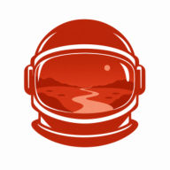

# Arcadia Pathfinder: safe Marswalks on Mars (NASA Space Apps 2026)

By team PhUnCy: Jacob Athavale, Tamanna Lather, Emma Harmos, Kayla Banasco, Ewan Raine, Jonathan Ishak (Western University).

A static web app, like a route planner for Mars, that finds safe routes between landing sites, science stops and
objectives (ice, minerals) and steers around hazards. It uses only measured data from NASA missions and peer-reviewed catalogs.

Region: Arcadia and Amazonis Planitia (37.5°N to 41°N, 171°W to 156°W, about 207 x 690 km), flat lowland plains with
shallow ice: SpaceX Starship candidate sites (S1-S9, HiRISE) and the NASA/SpaceX shortlisted sites AP-1, AP-8, AP-9, EM-15
and EM-16 (Golombek et al. 2021).

## Quick start (no coding needed)
1. Install Node.js 22 or newer from https://nodejs.org (the "LTS" button).
2. Download this project: on GitHub, press Code, then Download ZIP, and unzip it.
3. Open a terminal in the unzipped folder (Windows: right-click the folder, "Open in Terminal") and run:

       npm install
       npm run build
       npm run preview

4. Open http://localhost:4173 in a web browser (Chrome, Edge, Firefox or Safari). Keep the terminal open while you use it.

## How to plan a route
1. On the map of Mars, click **Arcadia Planitia**, then **Enter sector**.
2. Under **1 Start**, pick a landing site from the menu, or click the map where you are.
3. Under **2 Destination**, pick a tab (**Ice**, **Minerals**, **Sites** or **Map pin**) and click a target, or click the map.
4. Three routes appear straight away: **Safest**, **Balanced** and **Shortest**. Click a card to choose one, then read
   **Summary**, **Directions** (with true bearings and hazard warnings) or **Profile** (heights along the route).
5. Press **Go** to play the route back with distance left, which way to head and hazards ahead.
   Press **3D view** to see the land around the route.
6. Right-click (or long-press) anywhere for "What's here?": height, slope, ice, minerals, loose ground and crater rims there.
   **Go to a place** at the top jumps to any site or objective. **Route options** sets the steepest slope allowed and how
   strongly to avoid loose ground and crater rims; the routes update when you change them.
7. The buttons at the top left of the map switch the base map: **Colour**, **Elevation**, **Terrain**.
   **Map key and data layers** explains the symbols and switches the ice, mineral, loose-ground and crater-rim layers on.

## Using it without internet (on Mars)
Once the app has been opened with internet and the page reloaded once, it works offline: the planner, the routes, the 3D
terrain and the **Terrain** base map are all computed on your device from the height data stored with the app, so they need
no connection and have no missing areas. The Colour and Elevation maps are pictures from NASA servers: they are saved
only for areas you have already looked at, so pan and zoom over those areas first if you want them offline.
Use the `npm run preview` version, not `npm run dev`, which does not save anything for offline use.
In Chrome or Edge you can also install it like an app (the install icon in the address bar).

## What it does
- World map: the whole of Mars in its own colours (Viking colour mosaic), with base-map buttons for MOLA elevation
  and Terrain. With Elevation on, a colour bar (km, measured from the MOLA tiles by `scripts/fetch_mola_global.py`) marks
  the cursor's height. Arcadia Planitia is open; Jezero, Gale and Oxia Planum are previews (`src/hub.js`).
- Terrain base map (`src/terrain.js`): shaded relief with contour lines, drawn in the browser from the measured MOLA height
  grids (463 m in the sector, 15 km elsewhere) for whatever zoom level is on screen. It has no missing tiles, stays sharp at
  every zoom, and works offline. Its colour is the region's average measured from the Viking mosaic.
- Reliable picture layers: the Viking and MOLA pictures stop at level 7 (about 325 m per pixel), so past zoom 9 they are
  hidden and the Terrain map shows, with a note; a tile NASA's server drops is tried again twice. The Terrain map is always
  underneath, so any gap shows real terrain.
- Cursor readout: latitude, longitude and elevation anywhere (≈ = 15 km world grid); slope, ice score and pyroxene index in the sector.
- "Go to a place": a menu of every site and objective; choosing one flies there and shows what is measured at it.
- Start from a landing site or a map click, Swap, draggable pins, Clear, and science stops (A, stops, B). Routes are found
  as soon as a start and a destination are set, and again when an option changes.
- Objectives: Ice (the 8 strongest SWIM spots, `src/targets.js`, or the nearest reachable ice from A), Minerals (the strongest
  OMEGA pyroxene detections), Sites, or a custom Pin. The Ice and Minerals tabs switch on their map layer.
- Three alternative routes: Safest, Balanced and Shortest (still under the slope limit). Cards compare distance, climb,
  steepest slope, loose ground and crater rims; click a card or a grey line to switch.
- Step-by-step directions ("Head east (092°) for 35.7 km") with true bearings and hazard notes; click a step to zoom to it.
  Mars has no global magnetic field, so bearings are from true north.
- "What's here?": right-click for measured elevation, slope, ice score, pyroxene, loose ground and crater-rim proximity.
- Route options: slope limit and penalty sliders for loose ground and crater rims.
- Go: plays the selected route back in about a minute, with distance left, heading and measured hazards in the next 1 km.
  It shows no times or speeds (there are no measured speeds for suited astronauts on Mars) and is not a position fix.
- 3D view of the area around the route, cut from the 463 m grid (`cropGrid`), with CTX imagery tinted to the region's measured
  Viking colour, a sky measured from Viking Lander 2's photo (PIA01522), and a follow camera when Go plays in 3D.
  Vertical exaggeration 3× to 12×, shown on screen. Repeated or grey CTX tiles are dropped (`src/tiles.js`).
- Elevation profile, a scale bar measured on Mars, and a collapsible map key that also switches the data layers. Works offline (PWA). Shareable link: the URL hash stores
  `startLat,startLon,endLat,endLon`.

## How routes are found
A* search in a Web Worker on an 8-neighbour grid of MOLA elevation cells (1/128°, about 462 m north-south).
Step cost = distance × (1 + k × slope° + hazard terms), where slope is the larger of the cell slope and the step grade.
Steps over the slope limit (default 15°) are blocked; cells with no elevation data are scored like a 75° slope, never as flat.
Safest uses k = 0.1 and the full slider penalties (default ×2), Balanced k = 0.05 and half, Shortest k = 0.01 and none.
Loose ground is a 0 to 1 score from TES thermal inertia (150+ firm, 60 or lower powder) and the TES Dust Cover Index
(0.95+ low dust, 0.92 or lower dusty); these cut-offs are ours. Crater rims score 1 on the rim crest of each catalog crater
1 km to 100 km wide, fading to 0 within a quarter of the radius (at most 2 km).

## Developer commands
    npm install
    npm run dev      # http://localhost:5173
    npm test         # 13 unit tests: maths, A*, hazards, targets, 3D crop, tiles, terrain map
    npm run build    # static site in dist/ (deploy to Vercel or GitHub Pages)

## Prepare data (one time, already done)
    python -m venv .venv && .venv\Scripts\pip install -r scripts/requirements.txt
    .venv\Scripts\python scripts/prep_dem.py 37.5 41 -171 -156 --layer ice=data/raw/swim/SWIM2_c0_1.tif ^
        --layer ti=data/raw/ti/ti_arcadia_wide.tif --layer dci=data/raw/dci/dci_16ppd.tif --craters data/raw/craters/craters2020.csv.zip
    cd scripts && ..\.venv\Scripts\python fetch_omega.py ..\public\data && ..\.venv\Scripts\python fetch_mola_global.py ..\public\data && cd ..
`prep_dem.py` reads `data/raw/mola.tif` (USGS DEM) and resamples every `--layer` raster onto the same grid, writing packed
Int16 grids `public/data/*.i16` and `dem.json` (with each grid's scale and offset; see `scripts/gridpack.py`).
`fetch_omega.py` downloads only the rows of the OMEGA pyroxene map that cover the box (about 6 MB) and adds `pyroxene.i16`.
`pack_bins.py` converts grids made by older versions (Float32 `.bin`).
Longitudes are -180..180 east. Distances use Mars radius 3389.5 km.

## Data sources
- Elevation: USGS Astrogeology, Mars MGS MOLA DEM 463 m, https://astrogeology.usgs.gov/search/map/mars_mgs_mola_dem_463m
- Base map: NASA Mars Trek WMTS: Viking MDIM 2.1 colour mosaic (USGS), MOLA colour shaded relief (463 m) and CTX global mosaic
  (5 m, Caltech Murray Lab), https://trek.nasa.gov/mars/
- World elevation readout: MGS MOLA MEGDR, 4 pixels per degree (Smith et al. 2003), NASA PDS Geosciences Node,
  https://pds-geosciences.wustl.edu/mgs/mgs-m-mola-5-megdr-l3-v1/
- SpaceX candidate sites and points of interest: HiRISE (University of Arizona) image centres of the "Candidate Landing Site for
  SpaceX Starship" and traverse-hazard images (2019-2026), https://www.uahirise.org (image IDs in `public/sites.json`)
- AP-1, AP-8, AP-9, EM-15, EM-16: Golombek, Williams, Wooster (SpaceX), McEwen et al. (2021), SpaceX Starship Landing Sites on
  Mars, 52nd LPSC, abstract 2420, Table 1, https://www.hou.usra.edu/meetings/lpsc2021/pdf/2420.pdf. AP-1, AP-8 and AP-9
  coordinates repeated in Luzzi et al. (2023), LPSC 54 abstract 2335, and studied in Luzzi, Heldmann et al. (2025), JGR Planets
  130(5), doi 10.1029/2024JE008724. The other AP sites (AP-2 to AP-5, AP-7, AP-10 to AP-13; there is no AP-6) appear only on the
  2021 abstract's map with no published coordinates, so they are not included.
- Minerals: OMEGA (Mars Express) global pyroxene map, BD2000 band depth, Ody et al. (2012), JGR 117, E00J14,
  doi 10.1029/2012JE004117; dataset MEX-M-OMEGA-5-DDR-GLOBAL-MAPS-V1.0 via the NASA PDS Geosciences Node,
  https://pds-geosciences.wustl.edu/mex/mex-m-omega-5-ddr-global-maps-v1/
- Ice: SWIM 2.0 combined ice consistency, 0-1 m (Planetary Science Institute / NASA), https://swim.psi.edu/SWIM2Products.php
- Thermal inertia: TES nighttime thermal inertia, Putzig & Mellon (2007), via the ASU JMARS map server, https://www.mars.asu.edu/data/tes_putzigti/nightside2007/
- Dust cover: TES Dust Cover Index, Ruff & Christensen (2002), https://www.mars.asu.edu/~ruff/DCI/dci.html
- Craters: Robbins & Hynek (2012) Mars crater database, 2020 release, https://craters.sjrdesign.net/
- Colours: Viking layer and 3D tint from the Viking MDIM 2.1 colour mosaic (measured average for this region #755a57)
- Erebus Montes landmark: USGS Gazetteer of Planetary Nomenclature, https://planetarynames.wr.usgs.gov/Feature/1821
- Related study (not on the map, site coordinates not verified): Luzzi et al. (2025), near-surface ice at candidate landing
  sites in northern Amazonis Planitia, JGR Planets, doi 10.1029/2024JE008724

## Limitations
- OMEGA pixels are about 1.5 km and its pyroxene index marks where pyroxene is detected, not how much there is. Most of the
  sector is dust-covered, so "not detected" does not mean no minerals.
- TES thermal inertia has a north-south orbit-track stripe near 164°W (values above 300 in a narrow column), so it is not
  used to mark rock outcrops. It still feeds the loose-ground hazard, where the stripe only lowers the penalty locally.
- 463 m cells: boulders, small craters, cliffs and anything under ~460 m are invisible.
- Ice, dust and thermal data are coarser than the grid (about 3 km): they mark zones, not exact spots.
- Ice scores here peak at 0.50 on a -1 to +1 scale: "likely" means the orbiter data is consistent with ice, not proof.
- Craters wider than 100 km are skipped as rims: these ancient basins are worn down and their relief is already in the slope grid.
- No travel times: there is no measured walking or rover speed on Mars for suited astronauts, so routes report distance,
  climb, slope and hazards only.
- Site positions are HiRISE image centres, not exact landing points. Directions are from the grid route, so headings are approximate.
- The CTX mosaic (used in the 3D view) has gaps and brightness seams, and its server sometimes repeats one tile or sends grey
  filler. The 3D view drops those tiles and shows coarser imagery of the right place,
  with the count on screen.

## Coding assistant
Claude Code, a coding assistant by Anthropic, helped write this code.
